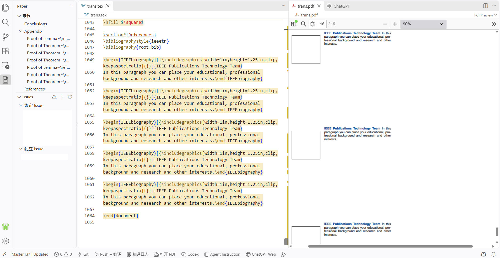
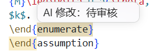
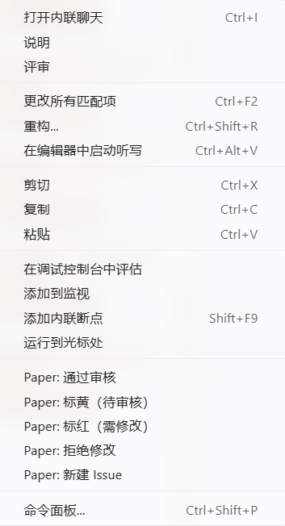
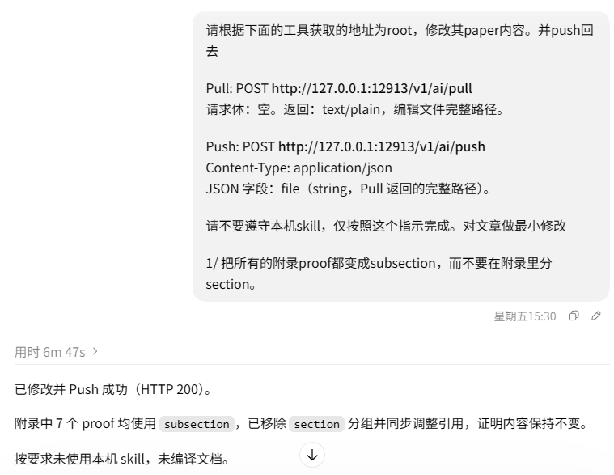
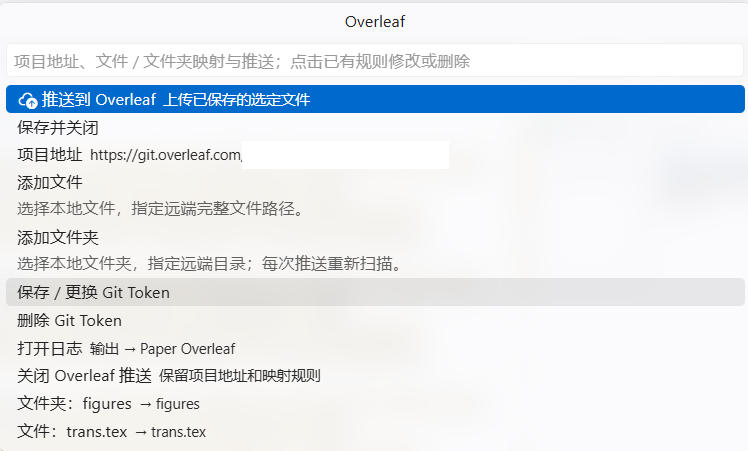

# Paper Review Tool

在 VS Code 中管理单个 LaTeX 文件，分开保存人工草稿与主版本，并持续审计 AI 修改。

## 安装

从 [GitHub Releases](https://github.com/hzzhang28/paper-review-tool/releases/latest) 下载 VSIX，在 VS Code 扩展视图的 **… → Install from VSIX…** 中安装，随后重新加载窗口。同一数字版本下的更新也需要覆盖安装。

- **查看 PDF 需自行安装内联 PDF 阅读扩展，并设为默认查看器。**
- 编译需安装本机 LaTeX 工具链；仅编辑正文可选择“不编译”。
- Agent 面板需自行安装对应扩展；Web 入口需要支持内联浏览器的新版 VS Code。

## 打开项目

目前需要先在 **VS Code 中打开论文文件夹作为工作区**，再通过 **Paper → 初始化 / 打开项目** 打开同一项目的 `.tex` 文件。两处都需要打开；只完成其中一步可能出现异常。此问题计划在后续版本修复。

点击 **Paper → 初始化 / 打开项目**，选择受管理的 `.tex` 文件。文件所在目录作为项目根目录。

首次打开时选择“全部已审核”或“全部待审核”。再次打开时加载已有人工草稿、审计状态、Issue 和历史。文件夹按钮可切换项目。

| 名称 | 含义 |
| --- | --- |
| Master | 磁盘上的唯一主版本 |
| Human Draft | 人工编辑的持久草稿 |
| AI 临时副本 | Agent 通过 HTTP 获取的可编辑文件 |

在 Human Draft 中写作，通过 Push 更新 Master。请避免其他程序直接覆盖 Master。

章节、Issue、审计高亮及 PDF 分栏示例：

## 保存与同步

| 操作 | 行为 |
| --- | --- |
| Ctrl+S | 只保存 Human Draft |
| Push | 提交正文、审计及 Issue 修改，不更新当前正文 |
| Update Only | 放弃本地修改，载入最新 Master；有修改时先确认 |
| Merge Update | 合并并提交本地修改，然后同步到最新 Master |
| Push + 编译 | 先 Push，再编译 Master；“不编译”方案只执行 Push |

状态栏中，`Unsaved` 表示未保存，`Unpushed` 表示未提交，`New Updates` 表示有待同步的 Master 更新，`Updated` 表示当前已同步。AI 提交会弹出通知，不自动替换 Human Draft。

## 审计与 Issue

黄色表示“待审核”，红色表示“需修改”，通过审核后清除高亮。选中文字或将光标放在词内，通过右键菜单操作；普通正文也能手动标黄或标红。再次修改待审核内容不会自动通过审核。“拒绝修改”用于撤回对应的 AI 修改。

待审核高亮及悬停提示：

右键菜单中的审计与 Issue 操作：

Issues 中，绑定 Issue 左键定位正文，右键 **编辑 Issue** 打开多行编辑页；独立 Issue 不绑定正文。支持删除、解决、重新打开和重新绑定。审计与 Issue 操作先保存到 Human Draft，Push 后提交。章节树用于导航，支持附录层级。

## 处理冲突

1. 点击状态栏 `Conflicts` 或 Issues 的“打开冲突”，在合并编辑器中处理差异。
2. 保存结果，点击 **提交合并结果**，一次更新 Master 与 Human Draft，并关闭本次合并标签。
3. 冲突处理中收到的新提交进入 `Pending` 队列；本次完成后按顺序继续，遇到新冲突再次暂停。

关闭合并标签不会解除暂停，重新打开可继续。已保存结果和已接收的 Pending 提交可在服务重启后恢复。

## Agent 与 Web

目前 VS Code 内的 Agent 插件集成尚不稳定，测试还未完成。建议使用外部 Agent App，并将 **Agent Instruction** 复制到任务开头作为预输入指令。

在设置中选择 **Default Agent** 和 **Default Web**。按钮名称随目标显示为 Codex、Claude Code、ChatGPT Web 或 Claude Web；“其他”可配置自定义目标。面板优先在 PDF 所在分栏打开，只有侧栏入口的扩展保留自身布局。

点击 **Agent Instruction**，复制已填入当前端口的 HTTP Pull / Push 指令。Agent 只需获取 AI 临时副本、修改文字并交回，版本与审计由服务处理。指令可在同名设置中编辑。

外部 Agent 调用示例，端口以当前复制的指令为准：

**修复 ChatGPT Web LaTeX 编译报错** 默认开启，仅对 ChatGPT Web 生效，通过调试连接将 LaTeX 代码块显示为源码；关闭后使用普通内联浏览器。切换已打开页面的模式会重开标签，请先保留未发送内容。

## 编译与 PDF

在 **Paper: 编译设置** 中选择平台和引擎：

| 选项 | 流程 |
| --- | --- |
| pdfLaTeX | 一遍编译 |
| pdfLaTeX + BibTeX | pdfLaTeX → BibTeX → pdfLaTeX → pdfLaTeX |
| XeLaTeX | 一遍编译 |
| XeLaTeX + BibTeX | XeLaTeX → BibTeX → XeLaTeX → XeLaTeX |
| 不编译 | N/A |

Windows 和 macOS 使用标准工具命令；其他平台或自定义命令选择“其他”。编译在 Master 所在目录执行，输出保留在该目录。可恢复错误下仍尝试生成 PDF，诊断保留在日志中。

内置方案使用 `-shell-restricted`，允许发行版白名单内的 EPS 自动转换。已有自定义方案若仍含 `-no-shell-escape`，需要自行改为受限模式；插件保留自定义参数。

**编译日志** 可打开或隐藏日志；**打开 PDF** 查看已有文件；**重新加载 PDF** 重开当前文件，不触发编译，可能重置页码或缩放。

## Overleaf 推送（可选）

Overleaf 推送已实现基础功能，当前配置界面仍较为简陋。

点击左侧 **章节** 面板标题栏的 **Overleaf** 云朵按钮，打开原生弹出配置界面。填写项目链接或 Git 地址，添加本地文件、文件夹及其远端路径，完成后启用。已有映射直接列出，点击可修改远端路径或删除规则；配置界面也提供推送入口，无需打开 Settings。项目需要具有 Overleaf Git 访问权限；Git Token 从 Overleaf 账户设置中生成，由 VS Code 安全存储保存。

文件规则指定远端完整文件路径；文件夹规则指定远端目录，留空表示项目根目录。文件夹在每次推送时重新扫描。上传时自动跳过文件名以 `eps-converted-to.pdf` 标记结尾的转换产物，保留原始 EPS 和普通 PDF。点击 **推送到 Overleaf**，上传所选范围的已保存文件；只新增或覆盖，远端旧文件保留。此操作独立于 Human Draft 的 Push，不自动保存或提交草稿，不提供 Pull。

该功能默认关闭，打开项目后即可看到 Overleaf 按钮。启用后，章节和正文标题栏的 **…** 菜单另有直接推送入口。可在 Overleaf 弹出界面关闭推送或删除 Git Token，映射规则保留。命令面板的 **Paper: Overleaf 配置** 也可打开同一界面。

推送日志位于 **输出 → Paper Overleaf**。可在 Overleaf 弹出界面点击 **打开日志**，或运行 **Paper: 打开 Overleaf 日志**；失败通知也提供 **查看日志**。日志记录执行阶段、HTTP 状态和底层错误原因，并过滤凭据，不另写日志文件。

## 存储与清理

点击 **章节** 面板标题栏的 **存储与清理** 按钮，查看数据库、Recovery 和 AI Session 占用，预览后整理存储、清理已完成 AI Session，或指定 Revision 删除更早的历史。例如填写 `30` 会删除 r30 以前的历史，保留 r30。清理不修改 Master 正文或重排版本号。

Settings 中的 `paperReview.storage` 可设置保留数量：已完成 AI Session 默认 3 份，正文历史默认无限（0），恢复快照默认 3 份。当前 Master、Human Draft、审计、Issue、未提交会话、Pending 和未解决冲突的必要依赖保留。历史删除不可恢复；仍被引用的旧快照会暂时保留。

## 开发与参考

源码打包使用本机 Node.js：`npm ci` 安装依赖，`npm run check` 检查语法，`npm run package:vsix` 生成安装包。依赖要求见 [package.json](https://github.com/hzzhang28/paper-review-tool/blob/main/package.json)。

[更新日志](https://github.com/hzzhang28/paper-review-tool/blob/main/CHANGELOG.md)

采用 [MIT 许可证](https://github.com/hzzhang28/paper-review-tool/blob/main/LICENSE)；第三方依赖遵循各自许可证。
